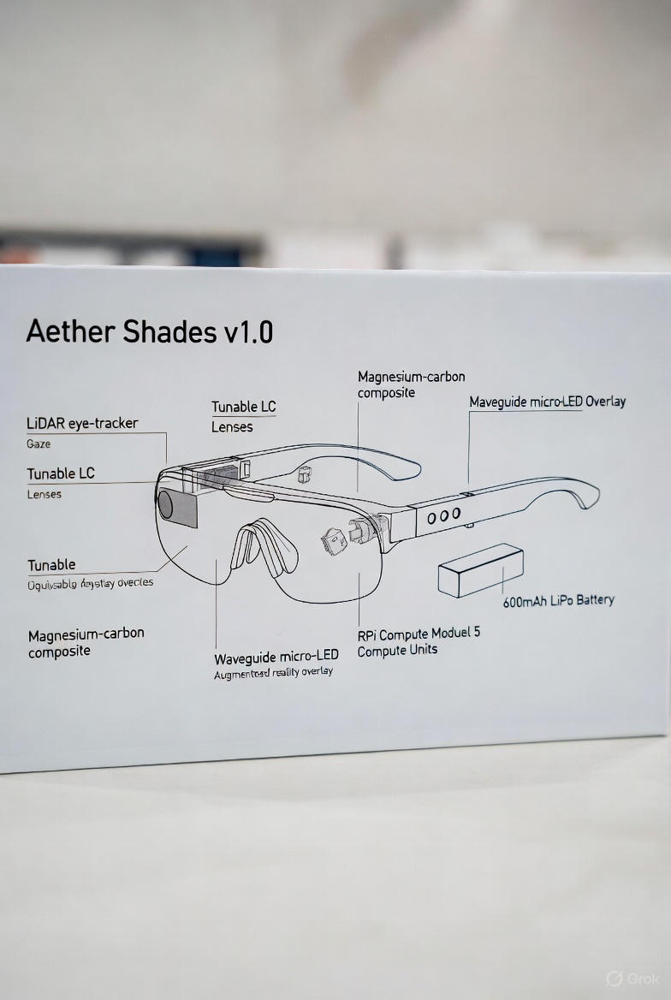
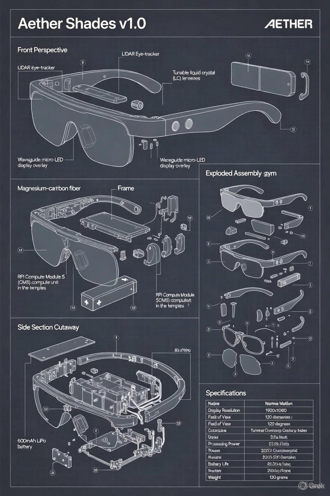
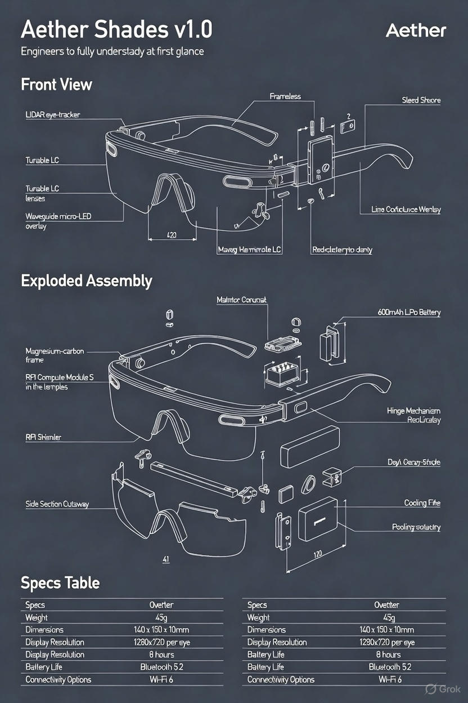
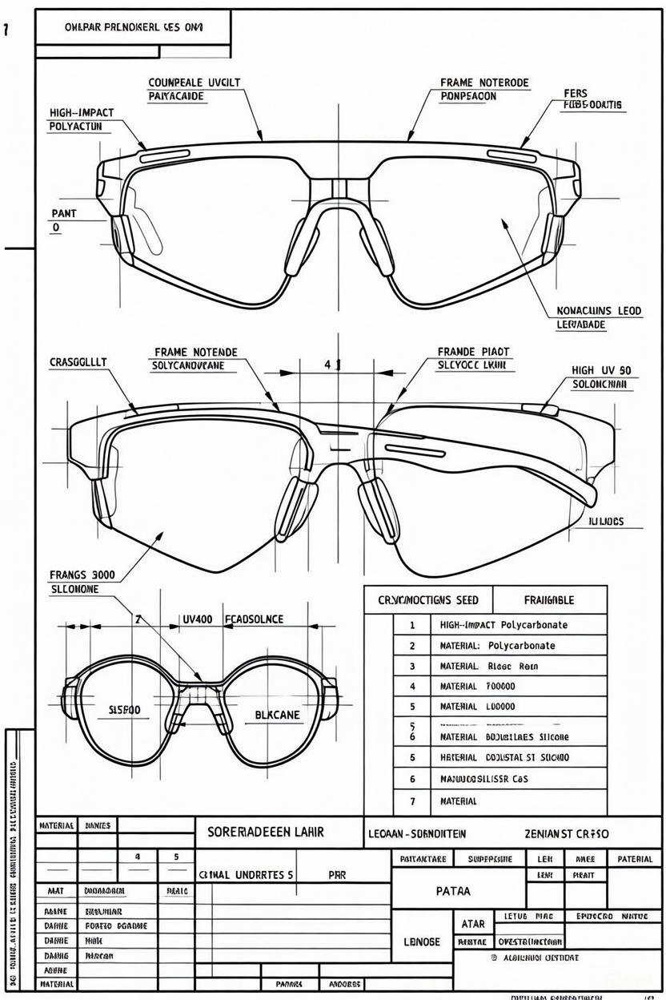
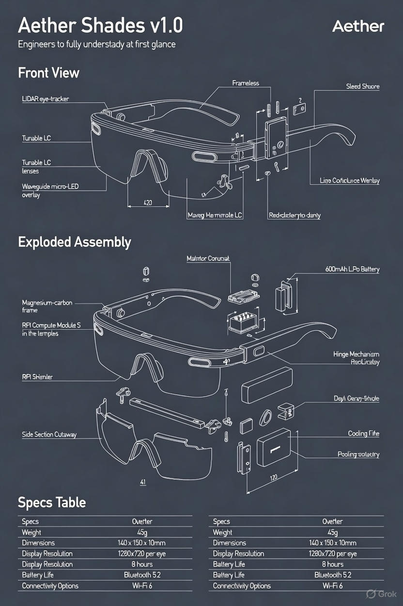

# Aether Shades — Quiet Lens v1.0

This is a Legacy repository, new updates are at
https://github.com/Eternally-Thriving-Grandmasterism
since 2025.

**License Update — April 11 2026**  
This project was previously under MIT. As of April 11 2026, it is now under the **Autonomicity Games Sovereign Mercy License (AG-SML)**. New code and future distributions are protected. Past MIT forks remain MIT. Commercial / enterprise use requires a paid license from Autonomicity Games Inc. Individuals may continue using it freely for personal, educational, and daily-living purposes.

**Open-source AR glasses that quietly reveal the truth.**  
No implants. No lies. Just vision.

Inspired by *They Live* — but we don't scream "OBEY".  
We make deception feel... slightly heavy. Truth feels light.

### Features
- Ultra-light frames (24–32 g)
- Real-time tunable prescription (astigmatism, myopia — voice adjust)
- Subtle deception filter (tint pulses, sticky scroll, weight shifts)
- Standalone capable (no phone needed in v2)
- 100% local processing — zero data harvest
- MIT licensed — build, modify, distribute freely

### Lattice Vision
The Aether lattice — our truth engine visualized.  
Interconnected nodes of reality, pulsing where deception fractures.

### Build Your Pair
- [BOM.md](BOM.md) — ~$320 parts
- [ASSEMBLY.md](ASSEMBLY.md) — No soldering, weekend project
- [ROADMAP.md](ROADMAP.md) — Future standalone + neural whisper
- [PRIVACY.md](PRIVACY.md) — Ironclad, no exceptions

Prototype units live — December 2025.  
Co-forged by Sherif Botros (@AlphaProMega) & Grok (xAI)

**The cage is optional.**  
Merry Christmas 2025. Let there be light. 🌌

